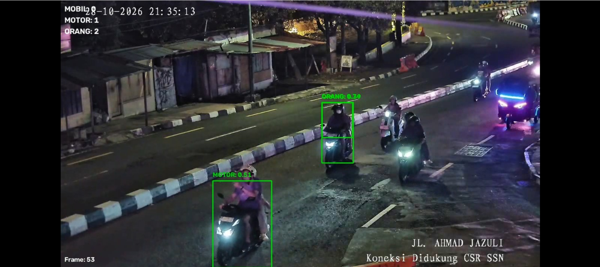
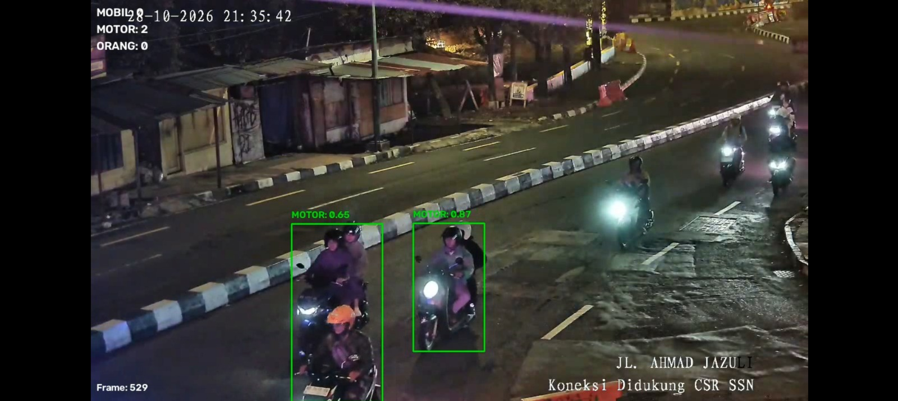

# Vehicle-Detection-and-Counting-using-YOLOv8
# 🚗 Vehicle Detection and Counting System using YOLOv8

Sistem pendeteksian dan penghitungan volume kendaraan berbasis *Computer Vision* dan *Deep Learning* menggunakan algoritma **YOLOv8 (Ultralytics)**. Project ini dirancang untuk melakukan analisis lalu lintas (*Traffic Monitoring*) pada rekaman rekaman CCTV area perkotaan (Yogyakarta) secara akurat dan *real-time*.

---

## 📸 Demo & Visual Output

| Deteksi & Bounding Box | Tracking & Counting |
| :---: | :---: |
|  |  |

---

## 📌 Features

- **Multi-Class Vehicle Detection**: Mendeteksi berbagai jenis kendaraan (Mobil, Motor, Bus, Truk).
- **Automated Vehicle Counting**: Menghitung jumlah kendaraan yang melintasi area/garis deteksi secara objektif.
- **Custom Roboflow Dataset**: Dilatih menggunakan dataset gambar/frame CCTV lokasi spesifik dengan anotasi kustom.
- **High mAP Performance**: Mengoptimalkan bobot model YOLOv8 untuk *precision* dan *recall* yang seimbang dalam berbagai kondisi pencahayaan.

---

## 🛠️ Tech Stack & Tools

- **Language**: Python 3.x
- **Computer Vision Framework**: Ultralytics YOLOv8, OpenCV
- **Dataset Management**: Roboflow Annotations
- **Environment & Training**: Google Colab (Tesla T4 GPU)
- **Data Manipulation & Plotting**: Matplotlib, NumPy, Pandas

---

